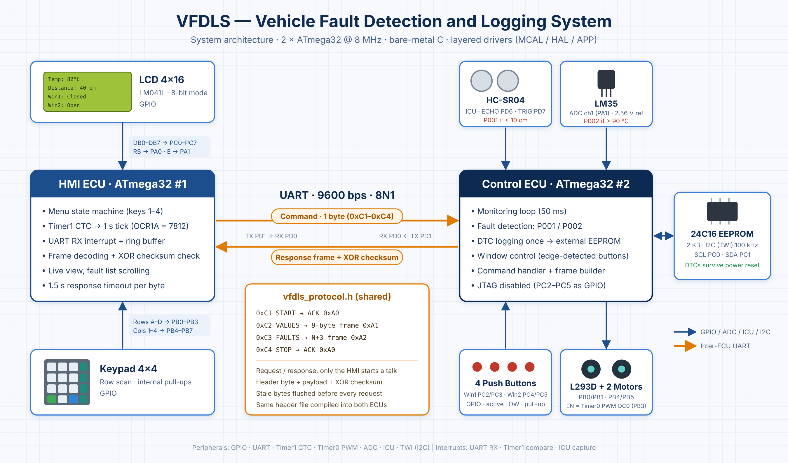
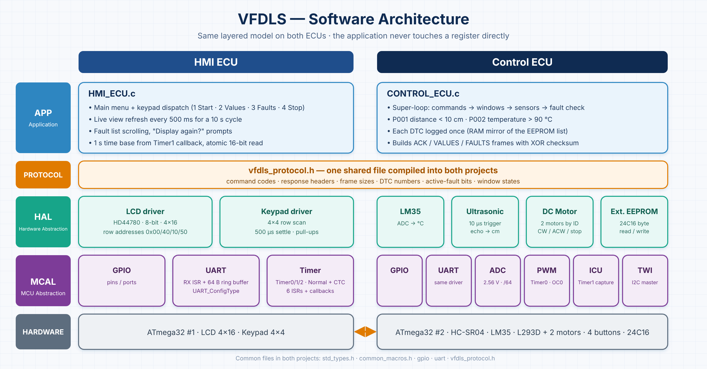
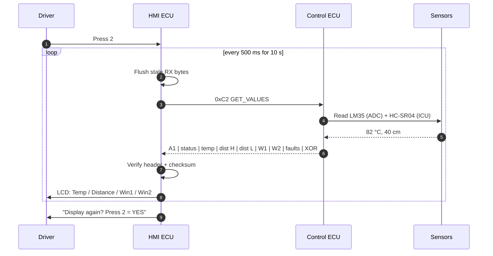
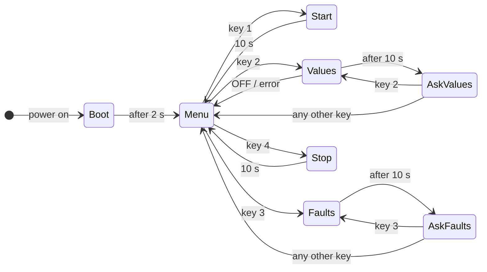
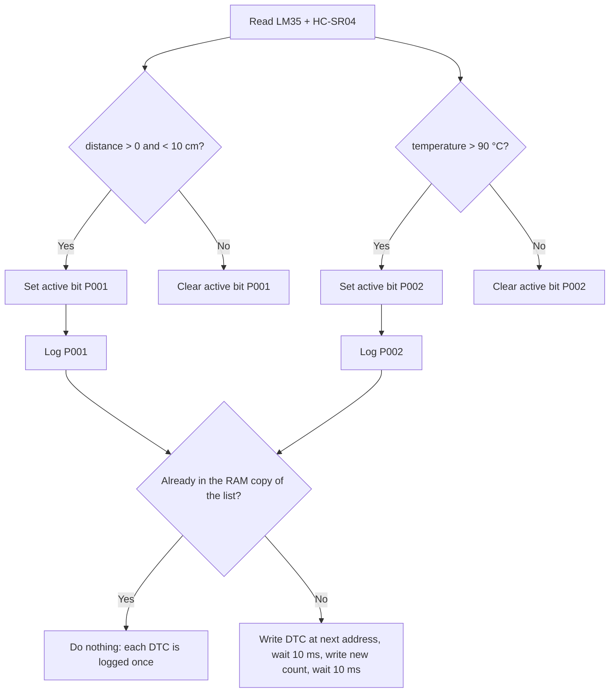
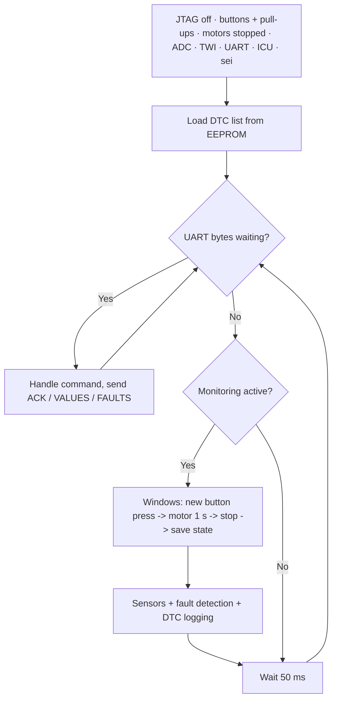

# VFDLS — Vehicle Fault Detection and Logging System


A two-ECU automotive diagnostics system on **two ATmega32 microcontrollers**. The
**Control ECU** monitors the car's subsystems (parking distance, engine temperature,
windows), detects faults in real time and logs **Diagnostic Trouble Codes (DTCs)** to an
external **I2C EEPROM** so they survive a power reset. The **HMI ECU** is the driver's
interface: a 4×16 LCD and a 4×4 keypad that talk to the Control ECU over **UART** using
a custom request / response protocol with checksums.

Final project of the Embedded Systems diploma at Edges For Training.

---

## Table of Contents

- [Highlights](#highlights)
- [System Architecture](#system-architecture)
- [Software Architecture](#software-architecture)
- [Hardware and Pin Map](#hardware-and-pin-map)
- [Communication Protocol](#communication-protocol)
- [Operation Cycle](#operation-cycle)
- [Fault Detection and DTC Logging](#fault-detection-and-dtc-logging)
- [Control ECU Main Loop](#control-ecu-main-loop)
- [Timing Budget](#timing-budget)
- [Drivers](#drivers)
- [Engineering Notes](#engineering-notes)
- [Project Structure](#project-structure)
- [Build and Simulate](#build-and-simulate)

---

## Highlights

- **Two cooperating ECUs** with a clear split of responsibilities, like a real vehicle network.
- **Custom UART protocol**: command codes, framed responses, XOR checksum, buffer flush and per-byte timeouts.
- **Interrupt-driven UART receive** into a 64-byte ring buffer, so no byte is lost while the CPU is busy.
- **Persistent fault memory**: DTCs written to a 24C16 EEPROM over I2C (TWI) and read back on every power-up.
- **Hardware timing**: echo pulses measured by the Timer1 **Input Capture Unit** (1 µs resolution), 1-second time base from Timer1 **CTC**, motor drive from Timer0 **PWM**.
- **Seven MCAL drivers** (GPIO, UART, Timer, ADC, PWM, ICU, TWI) and **six HAL drivers** (LCD, Keypad, LM35, Ultrasonic, DC Motor, External EEPROM), all configured through structures, as the specification requires.
- **One shared protocol header** compiled into both projects, so the two ECUs can never disagree on a command code or frame size.

---

## System Architecture

<p align="center"></p>

| ECU | Role | Peripherals |
|---|---|---|
| **HMI ECU** (ATmega32 #1) | Driver interface: menu, live values, fault list | LCD 4×16 (8-bit), Keypad 4×4, UART, Timer1 |
| **Control ECU** (ATmega32 #2) | Sensors, actuators, fault detection, DTC logging | HC-SR04 (ICU), LM35 (ADC), 2 DC motors (L293D + PWM), 4 buttons, 24C16 EEPROM (I2C), UART |

---

## Software Architecture

<p align="center"></p>

Each ECU follows the same three-layer model:

| Layer | HMI ECU | Control ECU |
|---|---|---|
| **APP** | `HMI_ECU.c` | `CONTROL_ECU.c` |
| **Protocol** | `vfdls_protocol.h` | `vfdls_protocol.h` (same file) |
| **HAL** | `lcd`, `keypad` | `lm35_sensor`, `ultrasonic`, `dc_motor`, `external_eeprom` |
| **MCAL** | `gpio`, `uart`, `timer` | `gpio`, `uart`, `adc`, `pwm`, `icu`, `twi` |

The application layer only calls driver APIs; every register access lives in the MCAL.
Changing a pin means editing one `#define` in a driver header.

---

## Hardware and Pin Map

### HMI ECU (ATmega32 #1, 8 MHz)

| Pin(s) | Connected to | Notes |
|---|---|---|
| PC0–PC7 | LCD DB0–DB7 | 8-bit data bus (JTAG disabled to free PC2–PC5) |
| PA0 / PA1 | LCD RS / E | RW tied to GND |
| PB0–PB3 | Keypad rows A–D | Driven LOW one at a time |
| PB4–PB7 | Keypad columns 1–4 | Inputs with internal pull-ups |
| PD0 / PD1 | UART RXD / TXD | Cross-connected to the Control ECU |

### Control ECU (ATmega32 #2, 8 MHz)

| Pin(s) | Connected to | Notes |
|---|---|---|
| PA1 (ADC1) | LM35 output | Internal 2.56 V reference, prescaler 64 |
| PD6 (ICP1) | HC-SR04 ECHO | Timer1 input capture |
| PD7 | HC-SR04 TRIG | 10 µs pulse |
| PB0 / PB1 | Window 1 motor IN1 / IN2 | L293D |
| PB4 / PB5 | Window 2 motor IN3 / IN4 | L293D |
| PB3 (OC0) | L293D EN1 / EN2 | Timer0 PWM, always 100 % |
| PC2 / PC3 | Window 1 Open / Close buttons | Active LOW, internal pull-ups |
| PC4 / PC5 | Window 2 Open / Close buttons | JTAG disabled to free these pins |
| PC0 / PC1 | 24C16 SCL / SDA | I2C at 100 kHz, 4.7 kΩ pull-ups |
| PD0 / PD1 | UART RXD / TXD | 9600 bps, 8N1 |

---

## Communication Protocol

All traffic is **request / response**: only the HMI ECU starts a conversation by
sending one command byte, and the Control ECU always answers with exactly one frame.
UART settings on both sides: **9600 bps, 8 data bits, no parity, 1 stop bit**
(double-speed mode, UBRR = 103, error ≈ 0.2 %).

### Commands (HMI → Control)

| Code | Name | Triggered by | Response |
|:---:|---|---|---|
| `0xC1` | START_MONITORING | Key 1 | ACK |
| `0xC2` | GET_VALUES | Key 2 (every 500 ms during the live view) | VALUES frame |
| `0xC3` | GET_FAULTS | Key 3 | FAULTS frame |
| `0xC4` | STOP_MONITORING | Key 4 | ACK |

### Response frames (Control → HMI)

**ACK** — 3 bytes

| Byte 0 | Byte 1 | Byte 2 |
|:---:|:---:|:---:|
| `0xA0` | echoed command | checksum |

**VALUES** — 9 bytes

| 0 | 1 | 2 | 3 | 4 | 5 | 6 | 7 | 8 |
|:---:|:---:|:---:|:---:|:---:|:---:|:---:|:---:|:---:|
| `0xA1` | status (bit0 = monitoring) | temperature °C | distance high | distance low | window 1 | window 2 | active faults (bit0 P001, bit1 P002) | checksum |

**FAULTS** — N + 3 bytes

| 0 | 1 | 2 … N+1 | N+2 |
|:---:|:---:|:---:|:---:|
| `0xA2` | count N | DTC numbers in logged order | checksum |

**Checksum** = XOR of every byte before it, header included. The HMI recalculates it
and drops any frame that doesn't match.

### Example: Display Values



### Robustness

| Problem | How it is handled |
|---|---|
| Bytes arriving while the CPU is busy | RX interrupt stores them in a 64-byte ring buffer |
| Old or partial bytes from an earlier exchange | RX buffer flushed before every request |
| Corrupted frame | Header and XOR checksum checked; bad frames are ignored |
| Control ECU not answering | 1.5 s timeout per byte, then "Comm Error!" on the LCD |
| Garbage / unknown command byte | Ignored by the Control ECU |
| UART framing / parity / overrun errors | Counted and discarded inside the ISR |

---

## Operation Cycle

### HMI state machine



### Screens

| Key | LCD |
|:---:|---|
| Menu | `1.StartOperation` / `2.Display Values` / `3.RetrieveFaults` / `4.StopMonitoring` |
| 1 | `Operation` / `Started!` / `Monitoring` / `Active...` → menu after 10 s |
| 2 | `Temp: 82°C` / `Distance: 40 cm` / `Win1: Closed` / `Win2: Open` → after 10 s `Display again? Press 2 = YES` |
| 3 | `Logged Faults:` / `P001:TooClose` / `P002:Overheat` / `--End of List--` → after 10 s `Display again? Press 3 = YES` |
| 4 | `System Monitoring` / `Stopped!` / `Returning to` / `Menu...` → menu after 10 s |

Messages from the specification that are longer than 16 characters are split over
two LCD lines.

---

## Fault Detection and DTC Logging

| Error description | DTC | Trigger condition |
|---|:---:|---|
| ACCIDENT_MIGHT_HAPPENED | **P001** | Distance < 10 cm |
| ENGINE_HIGH_TEMPERATURE | **P002** | Temperature > 90 °C |



### EEPROM memory map (24C16)

| Address | Content |
|:---:|---|
| `0x000` | Number of logged DTCs (0–10) |
| `0x001` … `0x00A` | DTC numbers in the order they happened (1 = P001, 2 = P002) |

- On power-up the Control ECU reads the list into RAM, so later checks don't need I2C traffic.
- A blank 24C16 reads `0xFF`; any count above 10 is treated as an empty memory and reset to 0.
- The 24C16 block address (A10..A8) is sent inside the I2C device address byte, as the datasheet requires.

---

## Control ECU Main Loop



---

## Timing Budget

| Item | Value | How |
|---|---|---|
| UART | 9600 bps | U2X = 1, UBRR = 103 at 8 MHz |
| HMI time base | 1.000 s | Timer1 CTC, F_CPU/1024, OCR1A = 7812 |
| Live view refresh | 500 ms | `_delay_ms` between requests |
| Ultrasonic resolution | 1 µs | Timer1 at F_CPU/8 in the ICU |
| Ultrasonic range limit | 65.5 ms of echo | 16-bit timer at 1 MHz |
| Control loop | ≈ 50 ms + measurement | HC-SR04 needs ≥ 60 ms between pings |
| ADC clock | 125 kHz | 8 MHz / 64 (datasheet: 50–200 kHz) |
| PWM frequency | ≈ 488 Hz | Timer0 fast PWM, F_CPU/64 |
| I2C | 100 kHz | TWBR = 32 |
| EEPROM write cycle | 10 ms | Wait after every byte |
| Window travel | 1 s | `WINDOW_MOVE_TIME_MS` |
| Keypad settle time | 500 µs | Before reading the columns |

---

## Drivers

| Driver | Layer | ECU | Key API |
|---|:---:|:---:|---|
| GPIO | MCAL | both | `GPIO_setupPinDirection`, `GPIO_writePin`, `GPIO_readPin` |
| UART | MCAL | both | `UART_init(const UART_ConfigType*)`, `UART_sendByte`, `UART_receiveByte` |
| Timer | MCAL | HMI | `Timer_init(const Timer_ConfigType*)`, `Timer_deInit`, `Timer_setCallBack` (Timer0/1/2, normal + compare, 6 ISRs) |
| ADC | MCAL | Control | `ADC_init(const ADC_ConfigType*)`, `ADC_readChannel` |
| PWM | MCAL | Control | `PWM_Timer0_Start(duty_cycle)` |
| ICU | MCAL | Control | `ICU_init`, `ICU_setCallBack`, `ICU_getInputCaptureValue` |
| TWI | MCAL | Control | `TWI_init(const TWI_ConfigType*)`, start / stop / write / read with ACK |
| LCD | HAL | HMI | `LCD_init`, `LCD_displayStringRowColumn`, `LCD_moveCursor` |
| Keypad | HAL | HMI | `KEYPAD_getPressedKey` |
| LM35 | HAL | Control | `LM35_getTemperature` |
| Ultrasonic | HAL | Control | `Ultrasonic_init`, `Ultrasonic_readDistance` |
| DC Motor | HAL | Control | `DcMotor_Init`, `DcMotor_Rotate(id, state, speed)` |
| External EEPROM | HAL | Control | `EEPROM_writeByte`, `EEPROM_readByte` |

The configuration structures follow the specification exactly, for example:

```c
typedef struct {
    UART_BitDataType  bit_data;
    UART_ParityType   parity;
    UART_StopBitType  stop_bit;
    UART_BaudRateType baud_rate;
} UART_ConfigType;
```

---

## Engineering Notes

Things that had to be solved on the way, mostly invisible in the final code:

- **JTAG pins.** PC2–PC5 are JTAG pins and JTAG is enabled by default, so the LCD data bus (HMI) and the window buttons (Control) did nothing. Both ECUs disable JTAG at start-up by writing `JTD` twice within four cycles, as the datasheet requires.
- **Shared 16-bit counter.** The 1-second counter is written in the Timer1 ISR and read in `main()`. The AVR reads 16-bit values as two bytes, so the read is wrapped in `ATOMIC_BLOCK` to avoid a torn value at 255 → 256.
- **Keypad in simulation.** With analog 10 kΩ resistors on the columns, the column line didn't fall in time for the read. The driver now waits 500 µs after driving a row LOW, and the internal pull-ups replace the external resistors.
- **LCD RW pin.** A net label named `U1_GND` left RW floating in Proteus, so the LCD ignored every write even though the data bus was correct. It is now tied to ground.
- **Ultrasonic at 8 MHz.** Timer1 at F_CPU/8 gives 1 µs per tick and a 65.5 ms window, longer than the HC-SR04's maximum echo.
- **EEPROM addressing.** The 24C16 has 2 KB in 8 blocks; the upper address bits go into the device address byte, not into the word address.
- **First reading.** A distance of 0 means "no echo yet" and is ignored, so P001 is never logged at boot.

---

## Project Structure

```
05_VFDLS/
├── Code/                          # Eclipse workspace with two projects
│   ├── HMI_ECU/
│   │   ├── HMI_ECU.c              # APP: menu, screens, protocol client
│   │   ├── vfdls_protocol.h       # Shared protocol definitions
│   │   ├── lcd.c / lcd.h          # HAL
│   │   ├── keypad.c / keypad.h    # HAL
│   │   ├── uart.c / uart.h        # MCAL
│   │   ├── timer.c / timer.h      # MCAL
│   │   ├── gpio.c / gpio.h        # MCAL
│   │   ├── std_types.h / common_macros.h
│   │   └── Debug/HMI_ECU.hex
│   └── CONTROL_ECU/
│       ├── CONTROL_ECU.c          # APP: monitoring, DTC logging, windows, protocol server
│       ├── vfdls_protocol.h       # Shared protocol definitions
│       ├── lm35_sensor.c / .h     # HAL
│       ├── ultrasonic.c / .h      # HAL
│       ├── dc_motor.c / .h        # HAL
│       ├── external_eeprom.c / .h # HAL
│       ├── adc · pwm · icu · twi · uart · gpio   # MCAL
│       ├── std_types.h / common_macros.h
│       └── Debug/CONTROL_ECU.hex
├── Proteus/
│   └── VFDLS.pdsprj               # Both ECUs + all peripherals
└── docs/
    ├── system_architecture.png
    ├── software_architecture.png
    ├── protocol_sequence.png
    └── hmi_state_machine.png
```

---

## Build and Simulate

1. **Eclipse:** File → Import → Existing Projects into Workspace → select the `Code` folder and tick both `HMI_ECU` and `CONTROL_ECU`.
2. Both projects are set to **ATmega32, 8 MHz, -Os** (`.settings/de.innot.avreclipse.core.prefs`). Build them to produce the two hex files.
3. **Proteus:** open `Proteus/VFDLS.pdsprj`. U7 (HMI) loads `..\Code\HMI_ECU\Debug\HMI_ECU.hex` and U2 (Control) loads `..\Code\CONTROL_ECU\Debug\CONTROL_ECU.hex`.
4. Run the simulation, press **1** to start monitoring, then try **2**, **3** and **4**. Move the LM35 above 90 °C or the obstacle closer than 10 cm to log P002 / P001.

Command line alternative (from each project folder):

```bash
avr-gcc -mmcu=atmega32 -DF_CPU=8000000UL -Os -std=gnu99 -o HMI_ECU.elf *.c
avr-objcopy -O ihex -R .eeprom HMI_ECU.elf HMI_ECU.hex
```
